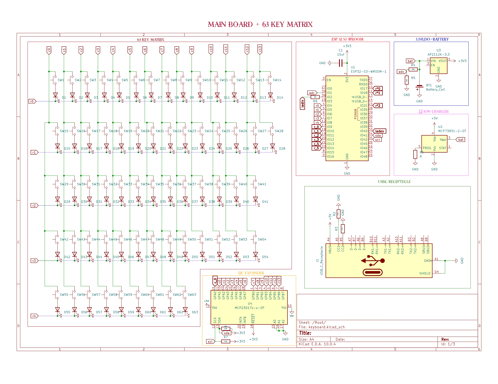

<h2 align="centre">Keyboard & co</h2>
hi,welcome to my little disaterously organised project, now keyboard&co is a modular keyboard made by Oliver and me , now im good at websites and schmatics apparently but pcbs are not my thinggg. 
the modular keyboard uses a esp32 s3 vroom , and pogo pins i think theyre called to connect each part of the keyboard. then it uses the same switches as a hack pad. bom etc is to come soon , journal rn is time lapses but will be fully updated by next ship
<h4>SCH</h4>

